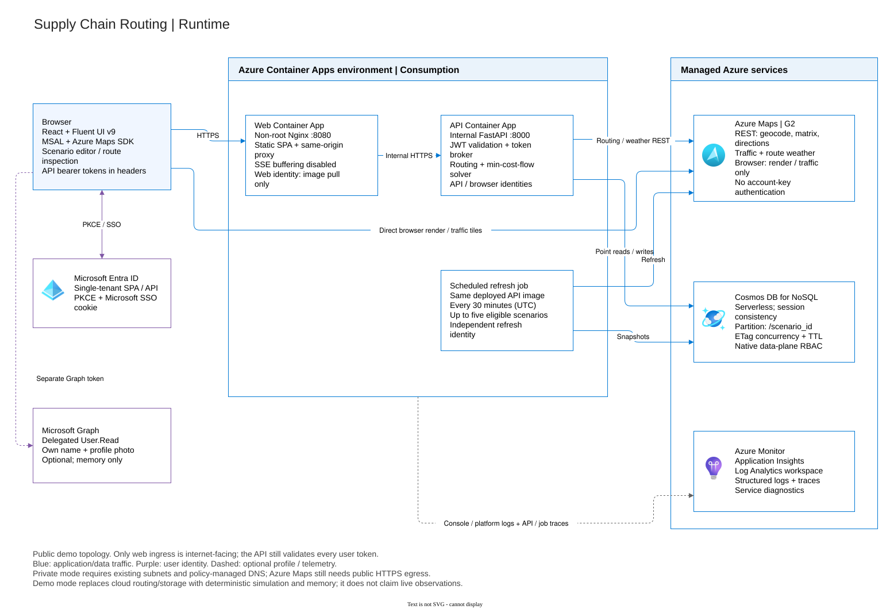

# Architecture

This demonstration plans **supplier-to-factory road lanes and shipment
allocations**, not vehicle dispatch. React/TypeScript provides the scenario
editor, Microsoft Fluent UI workspace, interactive map, and route comparison.
FastAPI owns routing,
optimization, persistence, and live-update orchestration.



The [editable draw.io source](.img/architecture.drawio) contains four pages:
**Runtime**, **Identity**, **Planning and data**, and **Delivery and operations**.
See the [diagram catalogue and editing instructions](docs/diagrams.md) for all
previews, and the [deployed resource inventory](docs/rg-scroute-eus2-architecture.md)
for the public demo's actual Azure resources. Diagrams contain no credentials.

## Runtime and identity boundaries

The non-root Nginx web container listens on **8080** and proxies `/api/` and
health requests to the internal FastAPI container on **8000**. It preserves the
browser Origin while using the upstream Host required by Container Apps routing.
SSE buffering is disabled. A single browser origin avoids cross-origin API
credential handling.
The static shell is public, but React gates the workspace behind MSAL sign-in.
Every data request and SSE stream carries an Entra bearer token. FastAPI checks
tenant signing keys, issuer, audience, expiry and delegated scope; UI gating alone
is not an authorization boundary. Health and nonsecret auth discovery stay public.
The map uses Microsoft's Azure Maps Web SDK directly; no unofficial React map
wrapper is required. The server brokers short-lived Maps authorization rather
than publishing an account key.

User tokens and workload tokens serve different audiences and are not
interchangeable:

| Principal / token | Authorized use |
| --- | --- |
| Signed-in user, delegated `access_as_user` | Scenario APIs, optimization, authenticated SSE, and browser Maps token broker |
| Same user, separate delegated Graph `User.Read` | Optional own name/photo; failures do not block routing |
| API and refresh managed identities | Maps Data Reader at the Maps account; native Cosmos NoSQL Data Contributor at the scenario container |
| Separate browser Maps identity | Only `services/render/read` and `services/traffic/read` at the Maps account |
| API, web and refresh identities | Registry-scoped `AcrPull`; web has no Maps/Cosmos data access |
| Deployment principal | Provisioning permissions, registry `AcrPush`, and Entra-authorized remote state access |

The API brokers a short-lived Maps token using the **browser identity**, not
its broader routing identity. The SDK then requests tiles/traffic directly
from Maps with that token and the Maps account client ID. Exact browser origins
are allowed; Maps/Cosmos/ACR account-key authentication is disabled.

MSAL caches the API sign-in session in `localStorage` and attempts cookie-backed
silent SSO once when no account is cached. Microsoft owns the Entra SSO cookie;
the app does not put raw tokens in its own cookies. Persistence remains subject
to browser restrictions, session expiry, consent and tenant policy. Explicit
sign-out clears the cache and locks other tabs. Graph profile artifacts/tokens
stay in memory. See [authentication](docs/authentication.md).

GitHub deployment workflows are manually dispatched and use OIDC rather than
client secrets. Their federation and GitHub environment configuration are
operator prerequisites, not resources created by the SPA registration module.

`APP_MODE=demo` explicitly uses in-memory storage and deterministic simulated
road data without cloud credentials. Its schematic is **not a road basemap**.
`APP_MODE=live` uses Azure Maps and Cosmos DB. An upstream failure must never
silently convert a live route into simulated data. Availability and partial-data
warnings are visible to the user.

## Planning pipeline

1. Validate the scenario, quantities, truck assumptions, and disruption targets.
2. Freeze the saved scenario in a new persisted run. `POST .../optimize` returns
   `202` with the run and a Location header; an optional `Idempotency-Key`
   reuses the corresponding run.
3. Reuse a scenario-scoped route cache, or call Route Matrix for all supplier /
   factory pairs. Skip explicitly unreachable cells; failed/incomplete responses
   fail the run rather than being treated as no route.
4. Obtain up to two Directions alternatives for **every reachable pair**.
   Directions supplies traffic-inclusive duration and actual road geometry.
   Sample each alternative's full road path for timed Weather Along Route
   forecasts; downsample geometry separately for bounded persisted snapshots.
5. Apply simulated disruptions, exclude closed candidates, compute itemized unit
   costs, and run the OR-Tools solver in a worker thread.
6. Persist routes, allocations, costs, warnings and terminal status in the run.
   The browser observes persisted stage events through SSE and fetches the
   complete run snapshot, with a polling watchdog.

Matrix is a screening tool: it does not return route geometry. Directions is the
source for detailed route measures. There is no additional top-k cost
shortlisting in this bounded implementation. Address lookup is an **explicit**
geocode action in the editor: choose coordinates and save before calculating;
optimization does not automatically geocode addresses.

Weather forecasts cover sampled pass-through times within 120 minutes of now.
Coverage gaps and partial failures produce warnings; a zero weather adjustment
is not an observation of clear weather. Truck restrictions and geographic
coverage must be checked before interpreting a route as commercially feasible.

## Optimization model

Let `x[s,f,r]` be shipment units sent from supplier `s` to factory `f` using
candidate road route `r`, and `c[s,f,r]` its unit cost.

```text
minimize  sum(c[s,f,r] * x[s,f,r])
subject to
  sum over f,r x[s,f,r] = supplier_supply[s]
  sum over s,r x[s,f,r] <= factory_capacity[f]
  x[s,f,r] >= 0
  excluded/closed lanes have zero capacity
```

OR-Tools provides the min-cost-flow solver. It is an intentional non-Microsoft
dependency: there is no suitable Microsoft-maintained Python replacement for
this constrained network solver. Microsoft Maps supplies the road network;
implementing A* or Dijkstra over our own road graph would duplicate the service
and would not supply its live traffic and truck restrictions.

This model differs from a vehicle-routing problem (VRP). It does not sequence
pickups, assign drivers, pack trucks, enforce hours-of-service, or model
inventory. Capacity is a factory's receiving capacity in shipment units.
Quantities and money are scaled to bounded integers where the solver requires
them. Quantity and objective-coefficient precision is **0.001**, also reported
in each run's warnings.

**Calculate shipment plan** solves the network allocation. Clicking a route
only inspects it: it does not rerun the solver, move allocated shipments, or
choose a new recommendation. Blue routes show positive recommended quantities;
purple emphasizes the inspected route; unused alternatives are hidden by
default and use dashed slate lines when enabled. Magenta previews identify
simulated disruption targets. The selected supplier-to-factory arrow and
START/END labels illustrate direction, **not live vehicle tracking**; animation
can be disabled and respects reduced-motion preferences.

## Explainable estimated costs

```text
unit cost =
    distance cost
  + driver time cost
  + estimated tolls
  + fuel cost
  + carbon cost
  + traffic delay penalty
  + weather delay penalty
  + simulated disruption penalty
allocation cost = shipment quantity * unit cost
```

Azure routing duration already includes traffic; do not add traffic minutes to
ETA a second time. ETA adds only separately modeled weather and simulated
delays. A delay penalty represents a business penalty, not another driving-time
charge. Avoid setting a distance rate that already includes fuel/labor unless
the corresponding explicit components are set to zero.

The current live Directions adapter cannot price tolls: zero toll cost is
explicitly **unpriced**, not a toll-free guarantee.
Toll amounts, fuel use, carbon factors, weather delays, and shipment-unit rates
are assumptions/estimates, **not carrier quotes or guarantees**. A weather-risk
indicator is not a calibrated probability. Actual traffic at a future departure
is unknown: the service can use historical/predicted traffic instead.

## Persistence and concurrent edits

The serverless Cosmos NoSQL container uses `/scenario_id` and Session
consistency. The stored document kinds are:

| Kind | Contents | Current TTL |
| --- | --- | --- |
| `scenario` | Full scenario, including embedded locations, cost/truck profiles and disruptions | 24 hours |
| `run` | Frozen input snapshot, deadline, run/result and ordered event array; routes/allocations are embedded | 1 hour |
| `maps_cache` | Route candidates and warnings keyed by locations, truck, departure and API versions | 5 minutes |
| `geocode` | Address lookup results | 1 hour |
| `latest` | Latest processed run ID | 1 hour |
| `active` | Eligibility timestamp for scheduled refresh | 24 hours |

These are not separate location, event or route collections. Point reads include
the partition key; writes use ETag conditions. Stale scenario mutations return
`412`, missing `If-Match` returns `428`, and clients must refetch rather than
overwrite. The container default TTL is 24 hours, overridden per document.
TTL is asynchronous cleanup, not guaranteed immediate deletion.

There is deliberately no shared mutable "current scenario". Each seed action
creates a new scenario identifier. Authentication limits API access to signed-in
users in the configured tenant. Users share the demo dataset: knowing a scenario
ID permits any authenticated user to access it. Per-user resource authorization
and business-data retention controls remain prerequisites for real information.

## Live updates and cost controls

SSE reads the ordered event array from the persisted run document. React uses
authenticated **fetch streaming**, not native `EventSource` or URL tokens.
Closed/failed streams fall back to a 2.5-second polling watchdog; the client
does not run an automatic SSE reconnect loop. Run/sequence IDs, timestamps and
scenario ETags guard against displaying obsolete results.

Recalculation creates a new frozen-input run. Browser refresh defaults to 60
seconds, with 2/5-minute and Pause controls; hidden tabs, dirty forms and active
runs are skipped. A **separate** Container Apps Job runs every 30 minutes (UTC)
for up to five recently active scenarios. It uses the deployed API image and its
own managed identity. Browser Pause does not stop this Azure job; job refresh
does not extend its own activity eligibility indefinitely.

Bound scenario size, request bodies, concurrent optimizations, retry budgets,
refresh work, and stored history. Cache upstream results only for an appropriate
freshness window and in accordance with Azure Maps terms. Debounce geocoding
and avoid re-fetching details on every render. Current live defaults allow
10 suppliers, 3 factories, two concurrent runs, a 180-second run deadline,
64 KiB request bodies and a five-minute Maps cache. API replicas remain at one
because claiming and request/concurrency limits are process-local.

At maximum size, a cold run can issue **91 upstream HTTP requests before
retries**: one matrix, up to 30 Directions, and up to 60 weather calls.

Azure Maps bills matrix cells, not simply HTTP calls. Batch requests reduce
transport overhead but do not make underlying route queries free. Monitor
Maps usage, Cosmos RU consumption, cache effectiveness, and retention.

## Reliability and observability

Use structured stdout logging, request correlation, readiness/liveness/startup
probes, Azure Monitor telemetry, and service diagnostics. Distinguish upstream
latency from optimizer duration. Retry only transient failures, with bounded
backoff and `Retry-After` handling. Partial weather availability must be
identified rather than presented as clear weather.

The MVP uses bounded in-process optimization orchestration with persisted
status. It is not a durable distributed task queue. Multi-region availability,
exactly-once execution, production SLA, disaster recovery, and fleet dispatch
are outside scope.

## Delivery, networking and code ownership

`azure.yaml` maps the API root and frontend to separate Container Apps.
Terraform references a **pre-created** resource group and remote Blob state
store; azd substitutes tfvars placeholders and captures outputs for deployment.
ACR remote builds publish immutable tags. Postdeploy hooks replace bootstrap
entrypoints and pin the refresh job to the deployed API image. Wait for healthy
latest-ready revisions before smoke tests.

Public mode exposes only web ingress to the internet, but permits
Entra-protected public data-service endpoints. Private mode uses supplied ACA /
endpoint subnets and policy-managed DNS; Maps still requires public HTTPS egress.
The demo's explicitly authorized `SecurityControl=Ignore` tag is not a
production recommendation. See [deployment](docs/deployment.md).

| Boundary | Implementation |
| --- | --- |
| Workspace, authenticated HTTP/SSE, SDK lifecycle | `frontend/src/` |
| Public wire models and validation | `src/template_repository/models/` |
| API, user-token verification, workload setup | `api.py`, `auth/`, `runtime.py` under `src/template_repository/` |
| Scenario/run orchestration | `src/template_repository/services/` |
| Azure Maps and deterministic simulation | `src/template_repository/routing/` |
| Itemized costs and transportation solver | `src/template_repository/optimization/` |
| Cosmos/memory implementations behind repository protocol | `src/template_repository/persistence/` |
| Provisioning, roles, diagnostics and deployment hooks | `infra/modules/`, `infra/scripts/` |
| Checks and manually dispatched OIDC deployment | `.github/workflows/` |

## Further reading

- [Routing and optimization research](docs/routing-research.md)
- [Local development](docs/local-development.md)
- [Configuration](docs/configuration-reference.md)
- [Azure deployment](docs/deployment.md)
- [Identity and SSO](docs/authentication.md)
- [Operations and troubleshooting](docs/operations.md)
