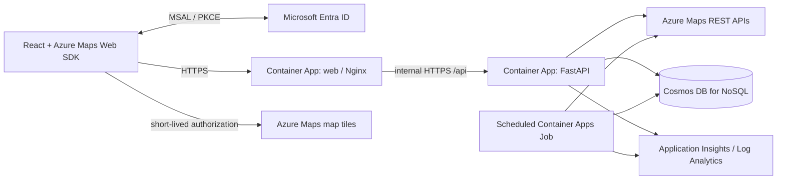

# Architecture

This demonstration plans **supplier-to-factory road lanes and shipment
allocations**, not vehicle dispatch. React/TypeScript provides the scenario
editor, interactive map, and route comparison. FastAPI owns routing,
optimization, persistence, and live-update orchestration.



## Runtime and identity boundaries

The public web container proxies API calls and server-sent events (SSE) to the
internal API. A single browser origin avoids cross-origin credential handling.
The static shell is public, but React gates the workspace behind MSAL sign-in.
Every data request and SSE stream carries an Entra bearer token. FastAPI checks
tenant signing keys, issuer, audience, expiry and delegated scope; UI gating alone
is not an authorization boundary. Health and nonsecret auth discovery stay public.
The map uses Microsoft's Azure Maps Web SDK directly; no unofficial React map
wrapper is required. The server brokers short-lived Maps authorization rather
than publishing an account key.

The API and scheduled refresh job use Azure user-assigned managed identities.
Cosmos DB uses data-plane RBAC, not account keys. ACR image pulls use workload
identity and `AcrPull`. GitHub Actions uses OIDC federation; deployment does not
require an Azure client secret.

`APP_MODE=demo` explicitly uses in-memory storage and deterministic simulated
road data without cloud credentials. Its schematic is **not a road basemap**.
`APP_MODE=live` uses Azure Maps and Cosmos DB. An upstream failure must never
silently convert a live route into simulated data. Availability and partial-data
warnings are visible to the user.

## Planning pipeline

1. Validate the scenario, quantities, truck assumptions, and disruption targets.
2. Resolve addresses, then obtain supplier/factory travel times and distances
   using Azure Maps Route Matrix.
3. Fetch Route Directions geometry and alternatives for candidate lanes. Enrich
   with traffic and route-weather estimates, subject to API coverage.
4. Compute an itemized unit cost per candidate route.
5. Solve a capacitated min-cost-flow transportation problem and persist progress
   and results. The browser observes run progress through SSE with polling fallback.

Matrix is a screening tool: it does not return route geometry. Directions is the
source for detailed route measures. Truck restrictions and geographic coverage
must be checked before interpreting the output as a feasible commercial route.

## Optimization model

Let `x[s,f,r]` be shipment units sent from supplier `s` to factory `f` using
candidate road route `r`, and `c[s,f,r]` its unit cost.

```text
minimize  sum(c[s,f,r] * x[s,f,r])
subject to
  sum over f,r x[s,f,r] = supplier_supply[s]
  sum over s,r x[s,f,r] <= factory_capacity[f]
  x[s,f,r] >= 0
  excluded/closed lanes have zero capacity
```

OR-Tools provides the min-cost-flow solver. It is an intentional non-Microsoft
dependency: there is no suitable Microsoft-maintained Python replacement for
this constrained network solver. Microsoft Maps supplies the road network;
implementing A* or Dijkstra over our own road graph would duplicate the service
and would not supply its live traffic and truck restrictions.

This model differs from a vehicle-routing problem (VRP). It does not sequence
pickups, assign drivers, pack trucks, enforce hours-of-service, or model
inventory. Capacity is a factory's receiving capacity in shipment units.
Quantities and money are scaled to bounded integers where the solver requires
them; displayed results must document the resulting precision.

## Explainable estimated costs

```text
unit cost =
    distance cost
  + driver time cost
  + estimated tolls
  + fuel cost
  + carbon cost
  + traffic delay penalty
  + weather delay penalty
  + simulated disruption penalty
allocation cost = shipment quantity * unit cost
```

Azure routing duration already includes traffic; do not add traffic minutes to
ETA a second time. ETA adds only separately modeled weather and simulated
delays. A delay penalty represents a business penalty, not another driving-time
charge. Avoid setting a distance rate that already includes fuel/labor unless
the corresponding explicit components are set to zero.

Toll amounts, fuel use, carbon factors, weather delays, and shipment-unit rates
are assumptions/estimates, **not carrier quotes or guarantees**. A weather-risk
indicator is not a calibrated probability. Actual traffic at a future departure
is unknown: the service can use historical/predicted traffic instead.

## Persistence and concurrent edits

The Cosmos container is partitioned by `/scenario_id`. Scenario, run, event,
and route documents are colocated by scenario. Use partition-scoped point
reads and ETag conditional updates; stale edits return `412` rather than
overwriting another edit. TTL bounds demo retention.

There is deliberately no shared mutable "current scenario". Each seed action
creates a new scenario identifier. Authentication limits API access to signed-in
users in the configured tenant. Users share the demo dataset: knowing a scenario
ID permits any authenticated user to access it. Per-user resource authorization
and business-data retention controls remain prerequisites for real information.

## Live updates and cost controls

SSE reports persisted run progress, with reconnect/polling behavior on the
client. Recalculation creates a new run instead of mutating the inputs of a
completed run. A scheduled Container Apps Job refreshes eligible scenarios;
browser updates must not overwrite unsaved edits.

Bound scenario size, request bodies, concurrent optimizations, retry budgets,
refresh work, and stored history. Cache upstream results only for an appropriate
freshness window and in accordance with Azure Maps terms. Debounce geocoding
and avoid fetching detailed geometries for every matrix cell on every render.

Azure Maps bills matrix cells, not simply HTTP calls. Batch requests reduce
transport overhead but do not make underlying route queries free. Monitor
Maps usage, Cosmos RU consumption, cache effectiveness, and retention.

## Reliability and observability

Use structured stdout logging, request correlation, readiness/liveness/startup
probes, Azure Monitor telemetry, and service diagnostics. Distinguish upstream
latency from optimizer duration. Retry only transient failures, with bounded
backoff and `Retry-After` handling. Partial weather availability must be
identified rather than presented as clear weather.

The MVP uses bounded in-process optimization orchestration with persisted
status. It is not a durable distributed task queue. Multi-region availability,
exactly-once execution, production SLA, disaster recovery, and fleet dispatch
are outside scope.

## Further reading

- [Routing and optimization research](docs/routing-research.md)
- [Local development](docs/local-development.md)
- [Configuration](docs/configuration-reference.md)
- [Azure deployment](docs/deployment.md)
