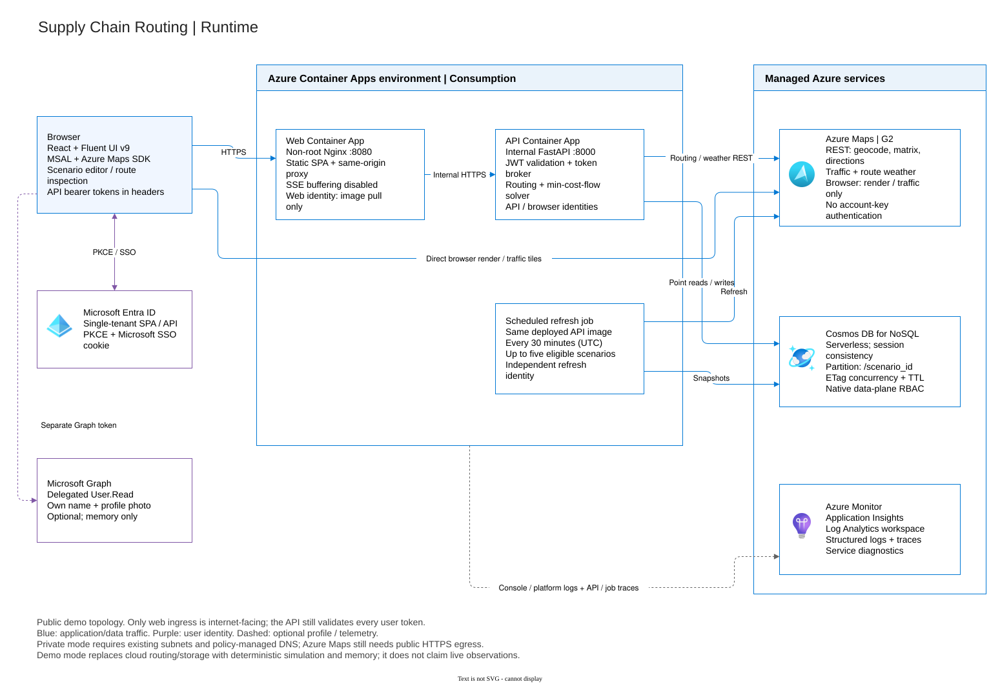

# Supply Chain Routing

A supplier-to-factory lane-planning demo built with React/TypeScript,
Microsoft Fluent UI, FastAPI, Azure Maps, Cosmos DB and Azure Container Apps.

Define suppliers and factories, compare alternative road lanes, allocate
shipment units within factory capacity, and explore estimated costs under
traffic, weather, and simulated disruptions.

The local demo requires no Azure credentials. Live mode uses Azure Maps and
Cosmos DB with managed identities. Azure deployments require Microsoft Entra
sign-in; the local demo explicitly disables user authentication.
This is a demonstration, not a dispatch system, carrier quotation engine,
or production supply-chain optimizer. Use synthetic data only: signed-in
tenant users share scenarios, with no per-user ownership boundary.

## What you can demonstrate

- Start with editable Houston-area suppliers and factories; geocode addresses,
  drag live map markers, and set supply, receiving capacity and truck assumptions.
- **Calculate shipment plan** minimizes total estimated shipment cost while
  assigning all supplier supply within factory capacity. Compare traffic-inclusive
  travel times, route-weather estimates and the eight-part cost breakdown.
- Recommended shipments are blue with quantities; inspection is purple and
  disruption previews are magenta. Unused alternatives are hidden by default.
  Inspecting a route does not reallocate shipments. A selected-route arrow and
  START/END labels show supplier-to-factory direction, not live vehicle tracking;
  reduced-motion and manual static modes are supported.
- Explore closures, facility delays, fuel changes and weather assumptions,
  then recalculate. See persisted run progress through authenticated SSE and a
  polling watchdog. Microsoft sign-in supports conditional return-session SSO
  and an optional **Howdy First Last!** profile/photo header.

## Architecture



The public Nginx web app proxies same-origin API/SSE requests to an internal
FastAPI Container App. Backend and refresh identities access Maps/Cosmos;
a separate least-privilege identity authorizes browser map/traffic tiles.
The scheduled refresh job uses the same deployed backend image.

[Architecture and cost model](ARCHITECTURE.md) |
[Four editable draw.io views](.img/architecture.drawio) |
[Diagram previews and editing](docs/diagrams.md)

## Local development (no Azure credentials)

Prerequisites: Python 3.12+, [uv](https://docs.astral.sh/uv/), Node.js 22.13+
(22 LTS or 24 LTS recommended), and npm.

```bash
uv sync --extra dev
cp .env.example .env
npm --prefix frontend ci
uv run supply-chain-routing
```

In another terminal:

```bash
npm --prefix frontend run dev
```

Open http://localhost:5173 and choose **Load Houston sample**.
Vite proxies `/api` to http://localhost:8000.
`APP_MODE=demo` explicitly selects simulated routing and in-memory persistence;
restarting the API clears local scenarios. No live traffic, weather, or road
basemap is claimed in this mode. `APP_MODE=live` requires configured Azure
services and never silently falls back to simulation. Follow the
[demo walkthrough](docs/local-development.md#demo-walkthrough) for saving,
planning, inspecting and disrupting routes.

## API and repository layout

- `GET /health` and `/health/live`: process liveness.
- `GET /health/ready`: dependency readiness.
- `GET /api/auth/config`: public, nonsecret sign-in configuration.
- `GET /api/config`: mode, routing/map availability and scenario limits.
- `GET /api/maps/token`: short-lived live map authorization; unavailable in demo.
- Scenario CRUD, geocoding, optimization runs, route details, disruptions, and
  progress events are under `/api/scenarios`.
- API docs: http://localhost:8000/docs.

Python imports remain `template_repository` and `uv run template-repository`
remains an alias for compatibility. Logs are JSON lines on stdout, configured at
startup without creating log files. Reload is enabled only with
`AZURE_ENVIRONMENT=development`; containers set it to `production`.

## Contracts and validation

Python wire models live in `src/template_repository/models/`; matching
TypeScript interfaces live in `frontend/src/types.ts`. JSON uses `snake_case`,
coordinates are `[longitude, latitude]`, quantities are supplier supply/factory
capacity, and timestamps include a timezone.

```bash
uv run ruff check .
uv run ruff format --check .
uv run mypy src/
uv run pytest -W error
uv build
npm --prefix frontend run lint
npm --prefix frontend run typecheck
npm --prefix frontend test
npm --prefix frontend run build
npm --prefix frontend run format:check
```

Use `uv run ruff format .` and `npm --prefix frontend run format` to format.
Repository-scoped VS Code tasks/debuggers in `.vscode/` cover setup, running,
packaging, tests, lint, formatting, types and infrastructure validation. The
existing `.code-workspace` delegates to these rather than duplicating tasks.

React/Vite and its test/lint toolchain are ecosystem dependencies; Microsoft does
not publish equivalent React build/testing tooling. The
optimizer uses OR-Tools because no suitable Microsoft-maintained Python
constrained-network solver exists. Azure integrations use Microsoft-maintained
identity/Cosmos libraries, and the map uses Microsoft's Azure Maps Web SDK.
Browser sign-in uses Microsoft's MSAL. PyJWT validates API token signatures
because MSAL acquires tokens but does not validate inbound API bearer tokens.
See [routing research](docs/routing-research.md) for algorithm tradeoffs and
first-party references.

## Containers and Azure deployment

```bash
docker build -t supply-chain-api .
docker build -t supply-chain-web frontend
```

The API listens on `8000`. The non-root Nginx web container listens on `8080`;
set `API_INTERNAL_URL` to the API's internal origin **without a trailing slash**
(default `http://api:8000`). It proxies `/api/` and `/health` without stripping the
path, with buffering disabled and a long read timeout for SSE. User API tokens
come from Entra through MSAL/PKCE; Maps tokens are brokered server-side.
No client secret or service key belongs in frontend environment variables.

`azure.yaml` maps services `api` (root) and `web` (`frontend`) to Container Apps.
Terraform tags apps with `azd-service-name=api|web`, exposes only web publicly,
configures workload identities/roles, and provisions Cosmos with `/scenario_id`
as partition key. Azure CLI, azd, Terraform, a pre-created resource group, and
remote-state storage are required for Azure deployment.

Read [deployment prerequisites](docs/deployment.md) before provisioning. Private
deployments use existing networking and policy-managed DNS. Public demo
ingress is protected by single-tenant Entra API authentication. The currently
deployed [Azure demo](https://ca-njk0ztnkmgrmn-web.icyflower-2a21f8a0.eastus2.azurecontainerapps.io/)
requires an account in the configured tenant and any required consent.
See [authentication and remembered sign-in](docs/authentication.md).
The approved `SecurityControl=Ignore` demo exception is not production guidance.

Infrastructure validation (after reviewing existing instructions):

```bash
terraform -chdir=infra fmt -check -recursive
terraform -chdir=infra init -backend=false
terraform -chdir=infra validate
```

`azd provision` prepares resources; `azd deploy` builds/deploys images and
synchronizes the refresh job. Wait for latest-ready revisions before smoke
tests. GitHub CI checks Python, React, Terraform, containers and Chromium on
push/PR; deployment workflows are separate, manually dispatched and require
configured OIDC federation and Azure environment inputs.

## Documentation

- [Architecture and cost model](ARCHITECTURE.md)
- [draw.io diagram catalogue](docs/diagrams.md)
- [Deployed Azure resource inventory](docs/rg-scroute-eus2-architecture.md)
- [Routing/optimization research](docs/routing-research.md)
- [Local development and walkthrough](docs/local-development.md)
- [Configuration](docs/configuration-reference.md)
- [Azure deployment](docs/deployment.md)
- [Entra authentication](docs/authentication.md)
- [Operations, limits, and troubleshooting](docs/operations.md)
- [Implementation checklist](.github/plans/supply-chain-routing-demo.md)

## License and disclaimer

See [LICENSE](LICENSE). This demonstration is provided as-is, without warranty;
route, weather, traffic and cost estimates are not logistics guarantees.
