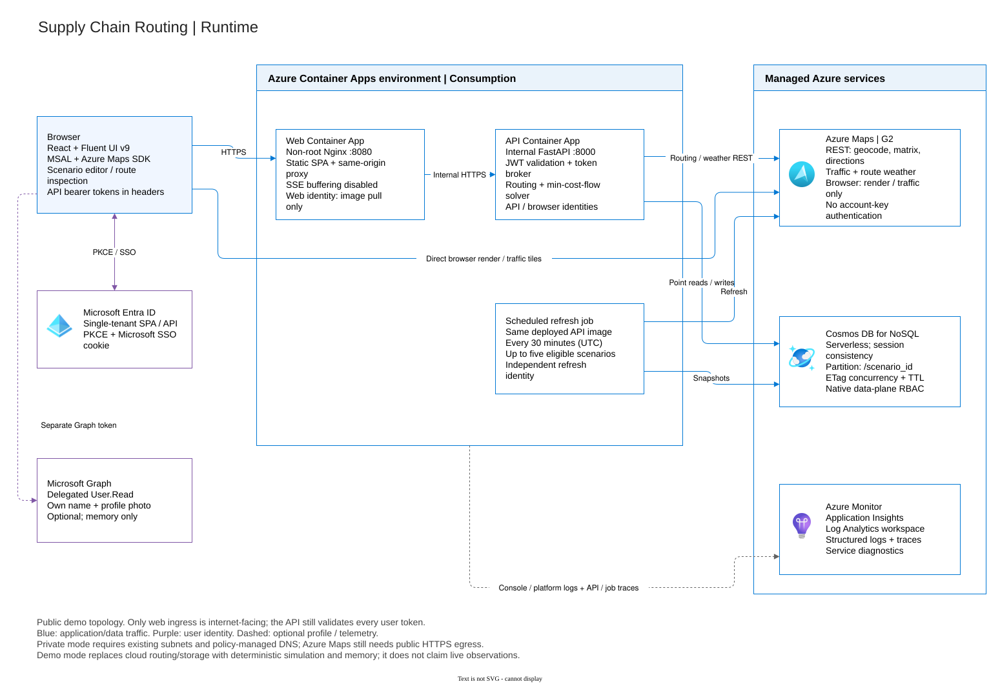
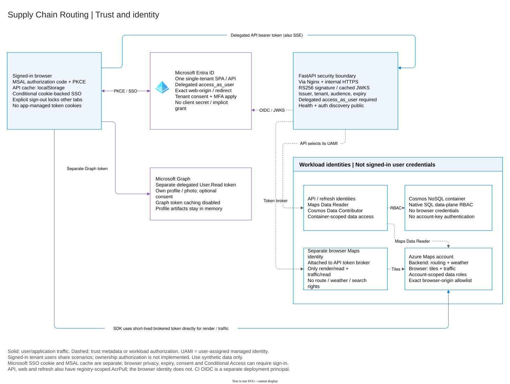
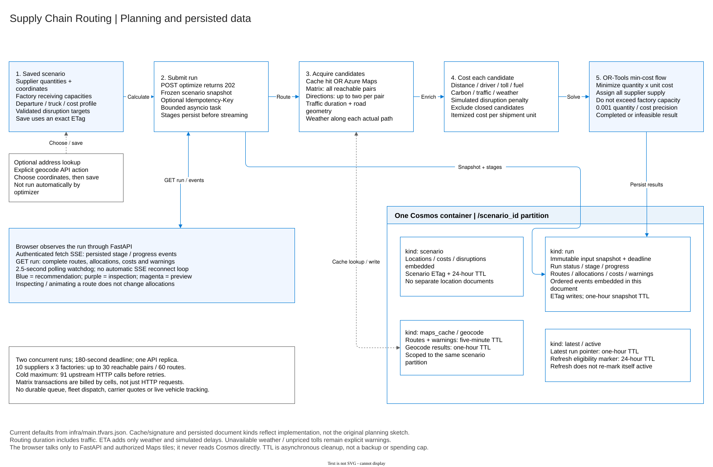
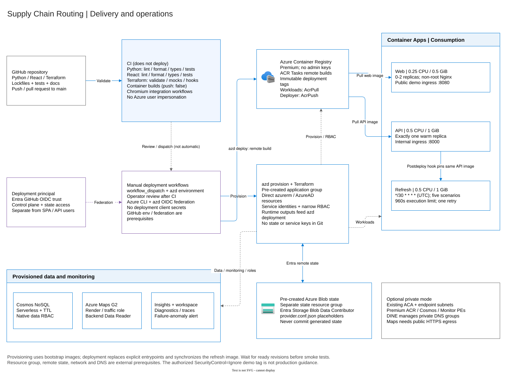

# Architecture diagrams

The canonical source is [`.img/architecture.drawio`](../.img/architecture.drawio),
an uncompressed, editable four-page draw.io document. Shapes, labels, connectors
and parent/child containers are editable; these are not flattened screenshots.
SVG previews are exported by draw.io with images embedded for GitHub rendering.

| draw.io page | Preview | Explains |
| --- | --- | --- |
| Runtime | [runtime.svg](../.img/runtime.svg) | Browser, public web, internal API, scheduled job and managed services |
| Identity | [identity.svg](../.img/identity.svg) | Delegated user/API/Graph tokens versus separate workload and browser Maps identities |
| Planning and data | [planning.svg](../.img/planning.svg) | Candidate acquisition, explainable costs, min-cost flow, run events and actual Cosmos document kinds |
| Delivery and operations | [deployment.svg](../.img/deployment.svg) | CI versus manual OIDC deployment, ACR images, azd/Terraform/state and optional private networking |

## Runtime

## Identity

## Planning and data

## Delivery and operations

## Editing and exporting

1. Open `.img/architecture.drawio` in the diagrams.net desktop/web editor or the
   VS Code draw.io extension. In the web editor, choose **Device** and open the
   local file; do not upload credentials, state or real supplier information.
2. Select a page using the tabs and edit its native shapes/connectors. Keep
   child shapes inside their parent containers and labels inside their bounds.
   Azure icons use diagrams.net's Azure2 library; generic process cards identify
   application components rather than substituting unrelated Azure products.
3. Save the **entire four-page source**. Export each selected page as SVG,
   with a white background and embedded images. Overwrite the corresponding
   preview listed above. Review the SVG at normal and reduced display sizes.
4. Commit source and previews together. Update [architecture](../ARCHITECTURE.md)
   and the [resource inventory](rg-scroute-eus2-architecture.md) when a
   relationship or deployment default changes. Run `git diff --check` and verify
   the relative preview links.

Blue connectors carry application/data traffic; purple denotes user identity;
dashed gray denotes configuration, telemetry or workload authorization.
Diagrams distinguish browser tile traffic from backend routing calls and show
actual document envelopes rather than the superseded original planning sketch.
Values are demo defaults, not performance guarantees or production guidance.

Microsoft Azure icons are supplied by the diagrams.net Azure2 library.
See the [draw.io export reference](https://www.drawio.com/docs/manual/export/export-to-svg/)
and [Azure icon guidance](https://learn.microsoft.com/azure/architecture/icons/).
