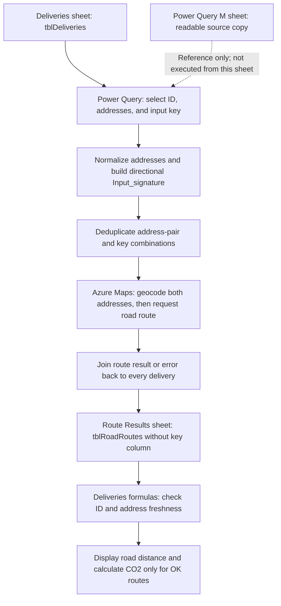
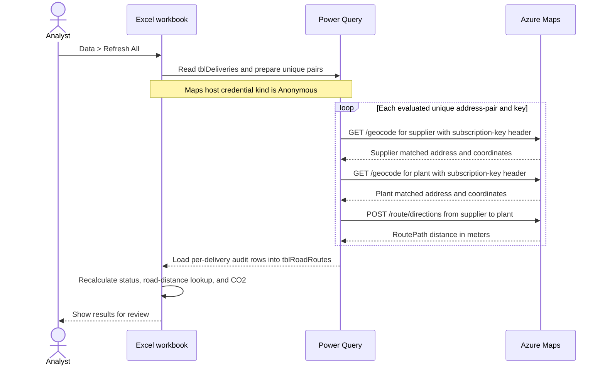
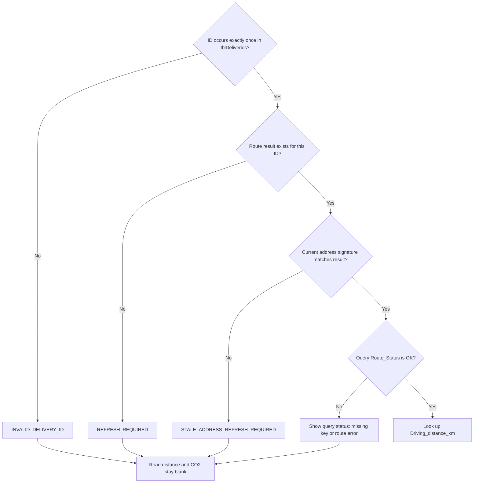
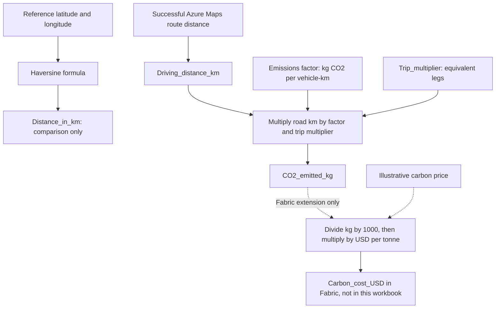

## Purpose and scope

The [Houston delivery workbook](../sample/Houston_Delivery_CO2.xlsx) demonstrates
address-based road-distance enrichment and vehicle-trip CO2 estimates in Excel.
Power Query retrieves routes from Azure Maps; worksheet formulas expose the
distance and calculate emissions for each delivery.

Use this approach for analyst-led review of a small delivery list, visible
spreadsheet formulas, and a desktop demonstration without Fabric capacity.
The [Fabric notebook approach](fabric-notebook-approach.md) adds staged
inspection, road-path storage, a Lakehouse, centralized carbon pricing, and a
published Power BI report.

The workbook does not allocate quantities across plants, calculate carrier quotes, apply
truck restrictions, or model weather and disruptions.

## Sample assets and their roles

* The [Excel workbook](../sample/Houston_Delivery_CO2.xlsx) contains delivery
  inputs, an embedded Power Query connection, cached results, and CO2 formulas.
* The [live CSV snapshot](../sample/Houston_Delivery_CO2_Live_20261109_1208.csv)
  provides reference results from an earlier run. Opening it makes no API calls.
* The [standalone Python script](../sample/houston_delivery_co2.py) performs
  similar address-based enrichment on local CSV rows using the standard library.
* The [Synapse notebook](../sample/Houston_Delivery_CO2_Synapse.ipynb) embeds the
  Python workflow for a Spark driver, with optional Key Vault and ADLS integration.

The 24 sample deliveries use dummy business names, quantities, and reference
coordinates. Addresses are public Houston landmarks, not actual supplier
relationships. Each delivery has its own ID; repeated directional address pairs
demonstrate reuse without treating separate trips as duplicates.

## Workbook structure

| Sheet           | Role                                                      |
| --------------- | --------------------------------------------------------- |
| `Start Here`    | Desktop refresh instructions and assumptions                |
| `Deliveries`    | Editable `tblDeliveries` table plus derived worksheet fields |
| `Route Results` | Query-loaded `tblRoadRoutes` audit and road-distance results |
| `Power Query M` | Readable copy of the `HoustonDrivingDistances` query source |

The embedded query is what runs during refresh. Editing the readable M text on
the `Power Query M` worksheet does not replace the connection's query. To change
its implementation, edit `HoustonDrivingDistances` in the Power Query Editor's
Advanced Editor.

### Delivery input columns

The input table uses these field groups:

* `Delivery_ID`: one unique, nonempty ID per physical vehicle trip
* Plant identifiers and labels: `PlantCode`, `PlantName`
* Plant address: `Plant_Street`, `Plant_City`, `Plant_RegionCode`,
  `Plant_PstlCode`, `Plant_CtryCode`
* Supplier identifiers and labels: `ManfactSupplier_ID`, `ManfactSupplier_Name`
* Supplier address: `ManfactSupplier_Street`, `ManfactSupplier_City`,
  `ManfactSupplier_RegionCode`, `ManfactSupplier_PstlCode`,
  `ManfactSupplier_CtryCode`
* Reference coordinates: `Plant_Latitude`, `Plant_Longitude`,
  `ManfactSupplier_Latitude`, `ManfactSupplier_Longitude`
* Descriptive part data: `Part_Qty`, `Part_UOM`, `Part_NetWeight_kg`, `WeightUnit`
* Calculation settings: `Emissions_factor_kgCO2_per_km`, `Trip_multiplier`
* Input-only shared-key credential: `Azure_Maps_API_Key`

Keep the existing `ManfactSupplier` spelling and preserve postal codes and IDs
as text. Country-name columns are descriptive; geocoding uses country codes.

`Distance_in_km`, `Route_Status`, `Driving_distance_km`, and `CO2_emitted_kg` are
derived fields, not independent route inputs. Add deliveries within the Excel
table so structured formulas expand; do not overwrite calculated columns with
manually invented road distances.

### Route audit columns

`tblRoadRoutes` contains the delivery ID, normalized supplier/plant addresses,
an `Input_signature`, status, driving distance, matched addresses, road-access
coordinates, `Refreshed_UTC`, and error reason/detail.

The key is excluded from that output table. The workbook retains it in its input
cells, however, so excluding it from query output does not make the saved
workbook safe to distribute.

## Desktop setup and refresh

The workbook targets desktop Excel for Windows with Power Query and working
HTTPS access to `atlas.microsoft.com`. Do not assume Excel for the web or another
spreadsheet application can execute this connection.

You need an Azure Maps account whose policy permits subscription keys and an
authorized key for that account. The sample does not provide an Entra sign-in
flow or automatically retrieve a Key Vault secret in Excel.

1. Make a working copy of the workbook and open it in desktop Excel.
2. Review `Start Here`, the dummy deliveries, and the data-connection source
   before allowing external connections.
3. Enter an authorized Maps key in `Azure_Maps_API_Key` (column AA) for the rows
   you intend to refresh. Treat the working copy as credential-bearing.
4. Choose **Data > Refresh All** and allow the approved connection.
5. If Excel requests credentials for `https://atlas.microsoft.com`, choose
   **Anonymous**. Power Query supplies the key in an HTTP header; Anonymous here
   does not mean the Maps request is unauthenticated.
6. Wait for query refresh to finish and let Excel recalculate formulas.
7. Review `Route Results`, then verify the status, driving-distance, and final
   CO2 columns in `Deliveries`.

If a previous Excel credential choice blocks the POST request, review
**Data > Get Data > Data Source Settings** for the Maps host, clear the incorrect
permission entry when appropriate, and reconnect with the expected credential
kind.

> [!WARNING]
> Refresh sends the address columns to Azure Maps and incurs API usage.
> Follow your organization's data-sharing and privacy policy. Do not disable
> privacy protections for sensitive deliveries. The workbook's dummy-data
> privacy-setting suggestion is not production guidance.

The worksheet positions in this sample are `Z` for straight-line distance,
`AD` for status, `AE` for road distance, and `AF` for CO2. Prefer column names
over letters when adapting the workbook.

## How Power Query gets a road distance

The query's data flow is:



The workbook contains both the credential-bearing inputs and the key-free
results. The last two boxes are worksheet calculations, not additional Maps
requests.

### Normalization and request reuse

The query converts the selected inputs to text, trims values, and normalizes
address whitespace. It joins street, city, region, postal code, and country code
with commas. The signature combines supplier and plant addresses in that order.

It buffers the prepared rows and distinct address-pair/key combinations.
Repeated deliveries can reuse a pair's route result during query evaluation.
This is not a persistent cache or a guarantee of an exact API-call count:
Power Query previews, reevaluation, retries, and another refresh may issue
requests again. Unlike the Python and Fabric variants, the M query does not
maintain a separate shared cache for an address used in different pairs.

### Address matching

The query sends `GET /geocode` to `https://atlas.microsoft.com`, with
`api-version=2025-01-01`, an encoded `query` address, and `top=1`.
It accepts `High` confidence with `Good`, and rejects ambiguous or hierarchy-only
matches. Road-access coordinates marked for `Route` are preferred over display
coordinates. GeoJSON coordinates are `[longitude, latitude]`.

Missing address components, invalid coordinates, or unacceptable matches fail
the route rather than substituting the workbook's approximate coordinates.
Review the returned matched addresses before trusting a successful route.

### Road routing

For a resolved pair, the query sends `POST /route/directions` with a GeoJSON
FeatureCollection containing supplier and plant waypoints. Options are
`travelMode="driving"`, `optimizeRoute="fastestWithoutTraffic"`,
`maxRouteCount=1`, and `routeOutputOptions={"routePath"}`.

The query selects the complete `RoutePath` and calculates:

```text
Driving_distance_km = RoutePath.distanceInMeters / 1000
```

It does not add unrelated response features or individual instructions.
Although it requests a route path, the workbook retains the distance and audit
coordinates rather than exporting all road vertices for mapping.

The route is supplier to plant. It is a fastest route without current traffic,
not the shortest possible road distance, and not a restricted heavy-truck route.



The sequence shows successful requests. A rejected match or request failure
instead produces a route error, and later requests for that pair may be skipped.
Anonymous is Excel's credential setting; each Maps request still carries the
key in its header. Query reevaluation and retries can add requests.

### Transport errors and retries

Requests use a 60-second timeout, initial pacing, and up to three retries after
the first attempt for selected transient HTTP statuses: `408`, `429`, `500`,
`502`, `503`, and `504`. The query applies exponential waits for retries.
Do not assume it retries every transport or credential failure.

Error output includes a sanitized reason/detail and null route metrics.
The query removes occurrences of the request key from diagnostic text and limits
detail length. Excel can intercept credential failures such as `401`/`403`
outside the query's manual HTTP-status handling, so check both the query
diagnostic and Excel's data-source settings.

## Worksheet formulas and freshness checks

### Straight-line comparison

`Distance_in_km` uses a Haversine formula with Earth radius 6,371 km and the
reference plant/supplier coordinates. It is a comparison metric only.
It is never a fallback for failed road routing and never drives the CO2 formula.

### Status and road-distance lookup

The `Deliveries` status formula checks, in order:

1. The ID occurs exactly once in `tblDeliveries`; otherwise
   `INVALID_DELIVERY_ID`.
2. A route row exists for the ID; otherwise `REFRESH_REQUIRED`.
3. The current address signature matches the query result; otherwise
   `STALE_ADDRESS_REFRESH_REQUIRED`.
4. The matching row's query status, such as `OK`, `MISSING_API_KEY`, or an error.



Follow the branches from top to bottom when a previously populated row becomes
blank after editing inputs. Only the successful path reaches the distance lookup.

`Driving_distance_km` is looked up only when that final status is `OK`;
otherwise it is blank. The formulas use delivery IDs to reconnect a query result
to its input row.

The signature detects address edits, not every possible freshness concern.
It is not a time-to-live check or an assertion that the key still works.
Inspect `Refreshed_UTC` and refresh when new road data is required.
Avoid blank IDs even though the workbook's ID formula primarily tests uniqueness;
the Python and Fabric workflows explicitly reject empty IDs.

### CO2 calculation

For a successful route with a nonnegative numeric factor and a positive numeric
multiplier:

```text
CO2_emitted_kg = Driving_distance_km * Emissions_factor_kgCO2_per_km * Trip_multiplier
```

If routing is not `OK`, the cell stays blank. Invalid factors or multipliers
produce `CHECK_FACTOR_OR_MULTIPLIER` rather than a numeric emissions result.

For illustration, a 12.3456 km trip at 0.270 kg CO2/vehicle-km with multiplier 1
produces 3.333312 kg CO2. This is arithmetic, not a measured sample route.
Changing only the factor or multiplier can recalculate CO2 locally without
requesting another road route.

The sample's 0.270 factor is illustrative, not an Azure Maps output or a
certified emissions factor. Replace it with a documented vehicle/fuel assumption.
This is CO2 per vehicle trip, not lifecycle CO2e or mass-based freight accounting.
Do not multiply again by `Part_Qty` or `Part_NetWeight_kg`.

One row means one trip. Consolidate part lines belonging to the same physical
trip before totaling emissions. `Trip_multiplier=2` approximates an equal-distance
return; an actual return-road calculation requires another unique delivery with
swapped supplier/plant addresses.

The workbook does not calculate the Fabric model's `Carbon_cost_USD`.
Fabric adds an illustrative cost using `CO2_emitted_kg / 1000 * USD_per_tonne`.



The straight-line branch deliberately stops at comparison. Part quantity and
weight are descriptive fields, not multipliers in the vehicle-trip calculation.

## Reviewing and troubleshooting results

Before sharing totals:

* Confirm every intended trip has a unique, nonempty ID.
* Count unsuccessful rows; a sum over successful or numeric cells alone can
  conceal missing emissions.
* Review matched addresses and supplier-to-plant direction.
* Check the refresh timestamp and address-staleness statuses.
* Confirm that factors, multipliers, and trip consolidation match your scenario.
* Keep blanks distinct from legitimate zero-length routes or zero factors.

For `MISSING_API_KEY`, supply an approved key in the relevant input row.
For a stale-address status, refresh after editing the address.
For `CHECK_FACTOR_OR_MULTIPLIER`, enter numeric settings with valid signs.
For geocoding failures, complete or correct the addresses instead of inventing
coordinates. For HTTP failures, inspect the account authentication policy, key,
quota, network access, and Excel credential settings.

Do not repeatedly refresh an unresolved authentication failure.
Refreshing can incur charges even when some deliveries fail.
The Excel M query has no explicit 1,000-row batch guardrail; the small sample is
not evidence that it is suitable for high-volume processing.

### Safe handling of workbook credentials

Prefer the Key Vault-backed Fabric or Synapse workflow when you need centralized
credential handling. For the Excel demo, restrict access to the working copy.
Remove input keys before distributing an approved sanitized copy, and review
connections and saved artifacts for other sensitive content.
Clearing a cell does not revoke a key or remove it from previously saved copies
and version history. Rotate a credential if it has been exposed.

Do not commit a keyed workbook, paste a key into query source, or put it in a
URL. Result-table redaction does not sanitize an entire workbook.

## Standalone Python alternative

The [Python script](../sample/houston_delivery_co2.py) uses only the standard
library and does not require Excel, Spark, or Fabric. Run it from the repository
root with the repository's `uv` environment:

```bash
uv sync --extra dev
uv run python sample/houston_delivery_co2.py --output houston-results-run-001.csv
```

With no `--input`, it generates the 24 dummy deliveries. With input:

```bash
uv run python sample/houston_delivery_co2.py \
  --input deliveries.csv \
  --output houston-results-run-002.csv
```

The CLI reads a local UTF-8 CSV, accepting a BOM and preserving IDs/postal codes
as strings. It does not read `.xlsx` files. Export the delivery table to CSV when
using workbook inputs.

Key selection is a nonempty per-row `Azure_Maps_API_Key`, then the default from
the existing `AZURE_MAPS_API_KEY` environment variable or a hidden terminal
prompt. Do not put keys in command arguments or shell history. The script does
not retrieve Key Vault secrets itself.

`process_deliveries` bounds batches to 1,000 rows, validates IDs, addresses,
factors, and multipliers, and clears prior route results before recomputing.
It keeps successful address and directional-route caches per key for one run.
Reference coordinates calculate an independent Haversine comparison.

Outputs preserve business columns and append matched addresses, route
coordinates, refresh time, statuses, error diagnostics, road distance, and the
final `CO2_emitted_kg` column. The API-key column is removed.
Expected input/API failures become `ERROR: <reason>` with null road distance and
CO2. The CLI can save a CSV containing failed rows; file creation or a zero exit
status is not proof that all deliveries routed successfully. Inspect its printed
status counts and row diagnostics.

Output uses exclusive creation, so an existing path is not overwritten.
Choose a new filename for each run. This variant does not export full road
geometry, calculate carbon costs, or publish a Power BI report.

## Azure Synapse notebook alternative

Import the [Synapse notebook](../sample/Houston_Delivery_CO2_Synapse.ipynb)
through **Synapse Studio > Develop > + > Import**, attach an Apache Spark pool,
and choose PySpark (Python). Its routing helpers use the standard library;
Spark and Synapse credential utilities come from the hosted runtime.

Configure:

* `KEY_VAULT_NAME`: vault name, not URL
* `KEY_VAULT_SECRET`: secret name, default `azure-maps-key`
* `KEY_VAULT_LINKED_SERVICE`: linked service for workspace-identity access
* `INPUT_PATH`: optional ADLS `abfss://` CSV path; empty selects the dummy data
* `OUTPUT_PATH`: optional fresh ADLS directory for Parquet results
* `MAX_ROWS`: default 1,000, for bounded driver-side processing

With a configured linked service, the workspace managed identity needs secret-get
access. Without one, interactive secret retrieval uses the user's identity.
The runtime also needs source-storage read access, optional output write access,
and network connectivity to the relevant services.

A configured vault secret overrides the environment default; a nonempty
per-row key overrides either. Prefer Key Vault over input-column secrets,
because Spark reads a key column as ordinary input data before sanitization.

Run all cells in order. Spark reads at most `MAX_ROWS + 1` input rows to detect
oversized batches; the actual HTTP calls run sequentially on the driver through
`process_deliveries`, not inside UDFs or `mapPartitions`.
Only sanitized output is converted to the displayed Spark DataFrame.
Numeric route metrics are explicitly cast so all-failure batches still have
nullable numeric output columns.

Review the result DataFrame and grouped status counts. When configured,
`OUTPUT_PATH` receives a Parquet directory, not one local file. Existing output
is rejected with `errorifexists`; use a new run directory. Rerunning the
calculation cell starts new caches and can repeat billable Maps requests.

Unlike the Fabric workflow, this notebook does not create Lakehouse tables,
export route-point geometry, refresh a semantic model, or publish a report.

## Moving from the sample to Fabric

The approaches share delivery IDs, address columns, trip-level assumptions, and
Maps API versions, but they are not interchangeable execution environments.

The [Fabric deployment CLI](../src/template_repository/fabric/cli.py) reads the
workbook's saved values, removes all key-named columns, and uploads normalized
CSV inputs. It does not refresh the embedded Excel query or rely on its road
results for new calculations. Fabric obtains its own credential from Key Vault,
geocodes and routes again, and adds geometry plus carbon cost.

Use the [Fabric notebook guide](fabric-notebook-approach.md) for the seven-stage
workflow and [Fabric operations](fabric-delivery-carbon.md) for deployment
commands, report access, and recorded validation.

## References

* [Azure Maps Geocoding API](https://learn.microsoft.com/en-us/rest/api/maps/search/get-geocoding?view=rest-maps-2025-01-01)
* [Azure Maps Route Directions API](https://learn.microsoft.com/en-us/rest/api/maps/route/post-route-directions?view=rest-maps-2025-01-01)
* [Power Query Web.Contents](https://learn.microsoft.com/en-us/powerquery-m/web-contents)
* [Synapse secure credentials](https://learn.microsoft.com/en-us/azure/synapse-analytics/spark/apache-spark-secure-credentials-with-tokenlibrary?pivots=programming-language-python)
