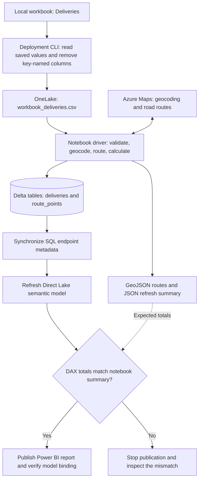
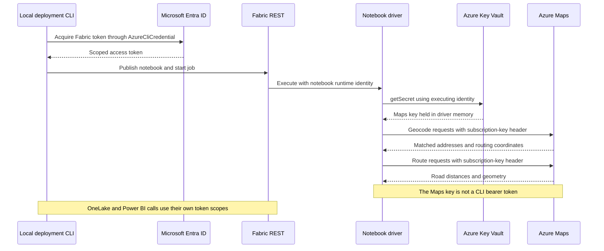
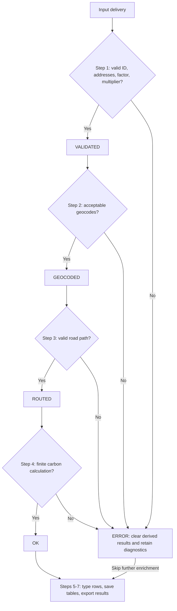
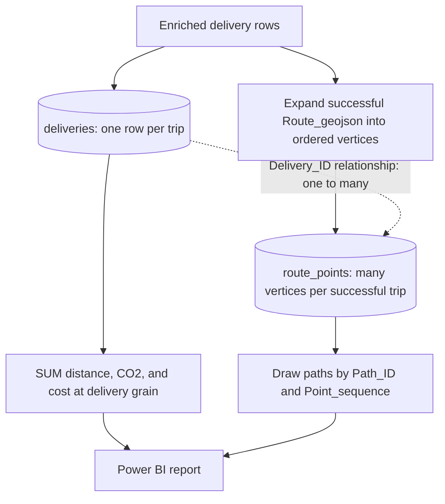

## Purpose and scope

The [Fabric notebook](../fabric/notebooks/Refresh_delivery_carbon.ipynb) turns
delivery addresses into measured road distances, estimated vehicle-trip CO2,
and illustrative carbon costs. It saves current-state analytics in a Lakehouse
and supplies a two-page Power BI report through a Direct Lake semantic model.

Use this approach when you want shared analytics, actual road geometry on a map,
inspectable processing stages, and repeatable publication. Use the
[Excel sample approach](excel-sample-approach.md) when you want workbook-based
review and formula-driven calculations without deploying Fabric.

This pipeline is separate from the React/FastAPI shipment-planning application.
It does not allocate shipments, optimize factory capacity, or use the
application's traffic, weather, and disruption cost model.

For the recorded deployment, report link, resource IDs, and operating commands,
see [Fabric delivery carbon operations](fabric-delivery-carbon.md).
Those deployment details are a recorded configuration, not a live health check.

## End-to-end data flow



The main path shows a complete successful batch. The CLI stops before model
publication if any delivery failed; it also stops if later verification fails.

The workbook's `Route Results` sheet and the supplied live CSV are uploaded as
reference snapshots. They are not substituted for new Azure Maps results.
The original workbook is not uploaded.

The [input reader](../src/template_repository/fabric/samples.py) reads workbook
XML directly. It does not open Excel, refresh Power Query, or execute formulas.
Save your workbook edits before deployment. Formula cells without usable cached
values can arrive as empty strings; routing and carbon fields are recomputed
rather than trusted as inputs.

## Input contract

Each row represents one physical vehicle trip from a supplier to a plant.
The sample has 24 fictitious deliveries, with repeated directional address pairs
but distinct delivery IDs. Public landmark addresses do not imply actual
supplier relationships.

Required columns are:

* `Delivery_ID`: nonempty and unique within the batch
* `ManfactSupplier_Street`, `ManfactSupplier_City`,
  `ManfactSupplier_RegionCode`, `ManfactSupplier_PstlCode`,
  `ManfactSupplier_CtryCode`: complete supplier address
* `Plant_Street`, `Plant_City`, `Plant_RegionCode`, `Plant_PstlCode`,
  `Plant_CtryCode`: complete plant address
* `Emissions_factor_kgCO2_per_km`: finite, nonnegative vehicle-km factor
* `Trip_multiplier`: finite number greater than zero

Preserve the existing `ManfactSupplier` spelling. Postal codes and IDs should
remain text in source data. Names, part quantities, part weights, and reference
coordinates can accompany the required columns, but they do not determine the
route or multiply the vehicle-trip emissions.

The notebook rejects an empty batch, batches above `MAX_ROWS` (default 1,000),
and input files larger than 4 MiB. Individual invalid deliveries remain as
`ERROR` rows so you can diagnose them without losing valid deliveries.
Invalid batch settings or file-level failures stop execution instead.

## Prerequisites and configuration

You need:

* A Fabric workspace on active supported capacity and permission to create or
  update its Lakehouse, notebook, semantic model, and report
* Permission to read and write the target OneLake files and tables
* A notebook runtime with PySpark, `httpx`, and Fabric NotebookUtils
* Network access from the runtime to Azure Maps and the configured Key Vault
* A Maps account that permits the authentication method being used
* Secret-read access for the notebook's executing identity
* Power BI permissions and applicable licenses for publishing and viewing
* Python 3.12+, `uv`, Azure CLI, and an authenticated CLI user for local deployment

The notebook's Spark-session and Lakehouse APIs are Fabric runtime dependencies;
the local Python environment alone cannot execute its complete workflow.

The [configuration file](../fabric/config.json) supplies nonsecret deployment
settings. Its principal fields are:

| Setting                      | Meaning                                                |
| ---------------------------- | ------------------------------------------------------ |
| `workspace_name`              | Expected workspace display name                        |
| `workspace_id`                | Existing workspace ID; empty enables name resolution    |
| `capacity_id`                 | Capacity used when the CLI creates a workspace          |
| `lakehouse_name`              | Target Lakehouse display name                          |
| `maps_client_id`              | Maps account client ID for the alternative bearer path  |
| `key_vault_url`               | Vault URL, not a secret value                           |
| `maps_secret_name`            | Name of the Maps subscription-key secret                |
| `carbon_price_usd_per_tonne`  | Finite, nonnegative illustrative price                  |
| `workbook`                    | Local workbook path                                    |
| `baseline_csv`                | Local reference CSV path                               |

When adapting the deployment, configure your own workspace, capacity, vault,
Maps account, and source paths. An existing `workspace_id` must match
`workspace_name`; a mismatch is rejected. Empty IDs allow lookup by name and
workspace creation when no match exists. Ambiguous names are rejected.

The deployment process does not provision the vault, grant permissions, enable
Maps shared keys, or resume paused capacity.

### Credential boundaries

The local [deployment CLI](../src/template_repository/fabric/cli.py) uses
`AzureCliCredential`. Fabric REST, OneLake, and Power BI receive tokens scoped to
their respective services. This credential is distinct from notebook Maps
authentication.

The checked-in notebook obtains the Maps subscription key with
`notebookutils.credentials.getSecret(KEY_VAULT_URL, MAPS_SECRET_NAME)`.
The key is held on the driver and sent in the `subscription-key` header, not a
query string. The configured Maps client ID is not a password and is not used by
this shared-key path.

The HTTP helpers also support bearer authentication, but changing a parameter
does not switch the checked-in notebook to that path. The current workflow uses
Key Vault because Maps-audience token acquisition was unavailable in the tested
Fabric runtime. Do not enable shared-key authentication on another account
without reviewing its security requirements.

Use least-privilege secret-read access for execution, and update the vault secret
when rotating the account key. Never put secrets in notebook cells, config,
source CSVs, command arguments, or report definitions.



The sequence shows the successful shared-key path. Vault authorization and Maps
authorization are separate checks; the CLI login does not itself grant either.

> [!IMPORTANT]
> Each stage prints full business rows, matched addresses, and, later, road
> geometry. Key-named columns are excluded, but this is not general-purpose
> sensitive-data detection. Notebook output and OneLake access still require
> appropriate protection. Use synthetic data for this demonstration.

## Running the notebook interactively

Open the [checked-in notebook](../fabric/notebooks/Refresh_delivery_carbon.ipynb)
in Fabric and attach the intended Lakehouse as its default Lakehouse.
Run the imports and helper-definition cells, then the configuration cell,
before executing the seven numbered steps in order.

Notebook parameters include `INPUT_FILE`, `MAX_ROWS`,
`CARBON_PRICE_USD_PER_TONNE`, `KEY_VAULT_URL`, and `MAPS_SECRET_NAME`.
The default input is `Files/sample/workbook_deliveries.csv`, relative to the
attached Lakehouse.

| Step | Result                         | External activity                         |
| ---- | ------------------------------ | ----------------------------------------- |
| 1    | `deliveries`, `validated`       | Read OneLake CSV; no Maps or vault calls   |
| 2    | `geocoded`                     | Retrieve secret; geocode unique addresses |
| 3    | `routed`                       | Request unique directional road routes    |
| 4    | `enriched`                     | Local CO2 and carbon-cost calculation     |
| 5    | `typed`, `schema`              | Local preparation for Spark storage       |
| 6    | `df`, `route_df`, `points`      | Overwrite two Lakehouse Delta tables      |
| 7    | `features`, `summary`          | Overwrite GeoJSON and JSON summary files  |



This is the row-level lifecycle, not batch-level exception handling. Errors stay
inspectable and are saved with null derived metrics; they do not become `OK`
merely because the notebook reaches its export cell.

### Step 1: Read and validate

The notebook checks file size before reading the CSV into driver-side
dictionaries. Validation removes key-named columns and old derived fields,
initializes a refresh timestamp and price, and checks IDs, factors, multipliers,
and addresses. Valid rows become `VALIDATED`.

Inspect the printed input and validated JSON before making billable requests.
Duplicate IDs are not collapsed into a single delivery: the affected rows fail
validation.

### Step 2: Geocode

For each uncached full address, the notebook calls
`GET https://atlas.microsoft.com/geocode` with API version `2025-01-01`,
the encoded address as `query`, and `top=1`.

It accepts only `High` confidence with a `Good` match code, rejecting
`Ambiguous` and `UpHierarchy` matches. A geocode point marked for `Route` usage
is preferred to the feature's display point. Coordinates are checked for finite
values and valid longitude/latitude ranges.

Successful rows receive matched addresses, road-access coordinates, and status
`GEOCODED`. Review the matched addresses even when validation succeeds.
Reference latitude/longitude columns are not used to resolve the route.

### Step 3: Request road routes

The notebook calls `POST https://atlas.microsoft.com/route/directions`,
again with API version `2025-01-01`. The GeoJSON request contains two Point
features in supplier-to-plant order, with these routing options:

```json
{
  "travelMode": "driving",
  "optimizeRoute": "fastestWithoutTraffic",
  "maxRouteCount": 1,
  "routeOutputOptions": ["routePath"]
}
```

GeoJSON coordinates are `[longitude, latitude]`. The response must contain one
complete `RoutePath`; its `distanceInMeters` is divided by 1,000.
Validated `LineString` or `MultiLineString` vertices are retained as
`Route_geojson`. Successful rows become `ROUTED`; carbon fields remain null.

This is a fastest road route without current traffic, not the shortest possible
distance. It is not commercial-truck routing and does not apply vehicle height,
weight, axle, or hazardous-cargo restrictions.

### Step 4: Calculate carbon

The calculation is local, with no REST calls:

```text
Driving_distance_km = distanceInMeters / 1000
CO2_emitted_kg = Driving_distance_km * Emissions_factor_kgCO2_per_km * Trip_multiplier
Carbon_cost_USD = CO2_emitted_kg / 1000 * Carbon_price_USD_per_tonne
```

For example, 12.3456 km at 0.270 kg CO2/vehicle-km with multiplier 2 produces
6.666624 kg CO2. At USD 100 per metric tonne, the illustrative cost is
USD 0.6666624. Round for display, not before calculating.

The sample factor is illustrative, not supplied or certified by Azure Maps.
This is not lifecycle CO2e, tonne-km freight accounting, a carbon-credit price
quote, or a monetary charge from Azure. Quantities and weights do not enter the
formula. A multiplier of 2 approximates an equal-distance return; use another
delivery row with swapped addresses and its own ID for an actual reverse route.

Only successful completed calculations receive status `OK`.

### Steps 5 and 6: Prepare and save tables

An explicit Spark schema keeps metric columns numeric even when every route
fails. Empty, invalid, or non-finite numeric values become null during storage
conversion; this conversion does not independently change a row's route status.

The notebook writes:

* `deliveries`: one row per delivery, including failures, metrics, matched
  addresses, route geometry, and diagnostics
* `route_points`: one row per successful road vertex, with `Delivery_ID`,
  `Path_ID`, `Route_segment`, `Point_sequence`, `Longitude`, and `Latitude`

`Path_ID` separates delivery segments and `Point_sequence` preserves vertex
order. Failed routes produce no points.



The dotted link is the semantic-model relationship, not another storage write.
Metrics stay at delivery grain; the map consumes vertex-grain data without
counting a delivery's emissions once per point.

> [!WARNING]
> Both tables are overwritten with schema replacement. The writes are separate,
> not a transaction across two tables. A failure between them can leave mixed
> refresh states. This is a current snapshot, not an append-only history store.

### Step 7: Export and assess completeness

The notebook replaces:

* `Files/sample/routes.geojson`: successful route features with delivery ID,
  CO2, and carbon cost
* `Files/sample/refresh_summary.json`: `deliveries`, `successful`,
  `route_points`, `road_km`, `co2_kg`, `carbon_cost_usd`, and
  `carbon_price_usd_per_tonne`

Totals sum available metrics; missing values contribute zero to those totals.
That does not turn a failed row's null metric into a valid zero-distance route.
Always compare `successful` with `deliveries`.

If every delivery fails, the notebook raises an error after saving diagnostics.
A partial-success batch can finish the notebook, but the CLI refuses to publish
the model/report unless every delivery succeeded.

## Reruns, failures, and API cost control

Stages copy their input rows, leaving `validated`, `geocoded`, `routed`, and
`enriched` available for comparison. Intermediate stages accept the expected
preceding status or `ERROR`; out-of-order input is rejected.
Errors are skipped by subsequent stages, not automatically retried as new rows.
Restart from validation after correcting delivery data.

Rerun all downstream stages after changing an upstream result. In an interactive
session, you can rerun carbon calculation and storage from existing `routed`
data without repeating Maps calls. A CLI `refresh`, by contrast, reruns the
entire notebook, including its network stages.

Requests run sequentially on the driver, never inside Spark UDFs or distributed
tasks. This avoids Spark retries duplicating billable HTTP calls. Successful
geocodes and directional routes are cached within their respective stage runs;
rerunning a network stage starts new caches. A route from A to B is not reused
as B to A.

The client uses a 60-second timeout, basic pacing, and up to four total attempts
for supported transient failures. It retries selected HTTP statuses
(`408`, `429`, `500`, `502`, `503`, `504`) and network failures with bounded
backoff. Authentication and input failures require correction.
These safeguards are not a quota guarantee or a bulk-routing design.

For row-level failures, `Route_Status` is `ERROR`, with `Route_Error_Reason` and
`Route_Error_Detail`. Derived route metrics, coordinates, geometry, CO2, and cost
are cleared, so an earlier successful result cannot silently survive a failure.
There is no Haversine or reference-distance fallback.

## Deployment and report publication

From the repository root:

```bash
az login
uv sync --extra dev
uv run python -m template_repository.fabric.cli deploy
uv run python -m template_repository.fabric.cli status
```

Use `--config path/to/config.json` after the command to select another config.
Paths in the config are interpreted relative to the process working directory.

| Command          | Input and refresh behavior                                    |
| ---------------- | ------------------------------------------------------------- |
| `deploy`         | Upload local inputs, publish/run notebook, publish model/report |
| `refresh`        | Publish/run notebook on existing OneLake input; publish report |
| `publish-report` | Reuse existing tables and summary; no notebook or Maps rerun   |
| `status`         | Resolve workspace; list items and read the available summary   |

To change source deliveries, edit the local workbook and run `deploy`.
Alternatively, replace the OneLake delivery CSV and run `refresh`.
Changing the configured price requires recalculation; `publish-report` does not
recalculate stored carbon costs.

The [notebook factory](../src/template_repository/fabric/notebook.py) preserves
the checked-in notebook's teaching cells, replaces its single tagged parameters
cell, clears execution outputs, and sets target Lakehouse metadata. If the
template is missing, it generates a compact workflow from the local Maps module.
Notebook-only parameter edits can therefore be replaced on the next CLI run.

After enrichment, the CLI synchronizes SQL endpoint metadata, publishes the
Direct Lake model, and requests a model refresh. DAX checks compare delivery and
point counts, failures, road km, CO2, and cost with the notebook summary.
The CLI then publishes the report and verifies its semantic-model binding.

The [semantic model](../src/template_repository/fabric/model.py) relates many
route points to one delivery. Financial and distance measures sum the delivery
table, not geometry rows. Multiple vertices must not multiply a delivery's cost.
The report contains overview and detail pages; it is not a separate Power BI
Service dashboard with pinned tiles.

Publication exports the [model definitions](../fabric/semantic-model/),
[report definitions](../fabric/report/), and
[deployment receipt](../fabric/deployment.json) locally. Those artifacts and a
successful notebook cell alone do not prove that the currently viewed report
has fresh data; use the CLI's end-to-end checks.

## Troubleshooting and verification

* If the input file cannot be found, check the attached default Lakehouse and
  `INPUT_FILE`, then verify that `deploy` uploaded the CSV.
* If Key Vault access fails, check the executing identity, secret-read
  permission, secret name, vault URL, and network policy.
* For `MAPS_HTTP_401` or `MAPS_HTTP_403`, check the account's authentication
  policy and secret rotation before retrying.
* For invalid geocodes, inspect complete and matched addresses; do not lower
  confidence checks to manufacture a route.
* If a notebook completes with partial results, inspect failed deliveries before
  treating aggregate totals as complete.
* If tables exist but publication fails, distinguish SQL metadata discovery,
  model refresh, DAX permissions, and report binding from notebook routing.
* If the report's map is unavailable, check the tenant Azure Maps visual setting,
  report permissions, capacity state, and licensing.

Local regression checks for the implementation do not make live Maps calls:

```bash
uv run pytest tests/test_fabric.py tests/test_fabric_notebook.py -W error
```

Live verification is separate and billable. Review summary completeness, matched
addresses, actual road paths, the report refresh timestamp, and the CLI's totals
and binding checks. No recurring refresh schedule is configured by this workflow.

## References

* [Fabric deployment and recorded validation](fabric-delivery-carbon.md)
* [Excel, Python, and Synapse sample approach](excel-sample-approach.md)
* [Azure Maps Geocoding API](https://learn.microsoft.com/en-us/rest/api/maps/search/get-geocoding?view=rest-maps-2025-01-01)
* [Azure Maps Route Directions API](https://learn.microsoft.com/en-us/rest/api/maps/route/post-route-directions?view=rest-maps-2025-01-01)
* [Fabric NotebookUtils credentials](https://learn.microsoft.com/en-us/fabric/data-engineering/notebookutils/notebookutils-credentials)
