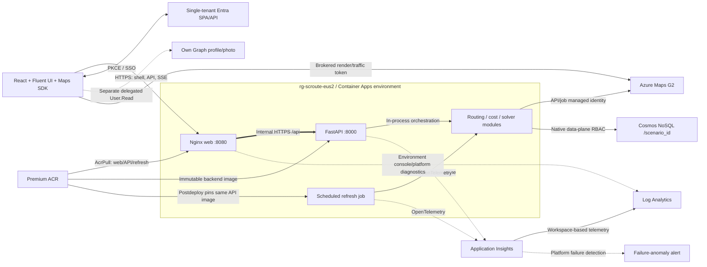

# Deployed demo resource architecture

The existing application resource group is **`rg-scroute-eus2`**, in
**East US 2**, selected by the azd **`demo`** environment. Azure Maps and the
platform-created failure-anomaly alert report a global resource location.
Subscription/tenant context is supplied by the operator's azd environment;
credentials and state are deliberately not reproduced here.

This is the public, single-region demonstration topology. Resource discovery
confirmed the inventory below and the web/API ingress ports and refresh
schedule. Terraform and application source establish the identity/data
relationships. This inventory does not prove a personal delegated sign-in,
production readiness or disaster recovery.

## Resource inventory

All 14 application-group ARM resources are included. Cosmos database/container,
role assignments and diagnostics are child/configuration resources.

| Resource | Type | Role / configuration |
| --- | --- | --- |
| `cae-njk0ztnkmgrmn` | Container Apps environment | Consumption; shared API/web/job hosting and Azure Monitor diagnostics |
| `ca-njk0ztnkmgrmn-web` | Container App | Internet-facing demo ingress on 8080; non-root Nginx; 0.25 CPU / 0.5 GiB; 0-2 replicas |
| `ca-njk0ztnkmgrmn-api` | Container App | Internal ingress on 8000; FastAPI; 0.5 CPU / 1 GiB; one warm replica |
| `ca-njk0ztnkmgrmn-refresh` | Container Apps Job | Scheduled `*/30 * * * *` UTC; 960-second limit; one retry; at most five eligible scenarios |
| `crnjk0ztnkmgrmn` | Container Registry | Premium; immutable web/API deployment tags; no admin keys |
| `cosmos-njk0ztnkmgrmn` | Cosmos DB account | Serverless NoSQL; Session consistency; database `supply-chain`, container `scenarios`, `/scenario_id`, TTL |
| `map-njk0ztnkmgrmn` | Azure Maps account | G2; Entra-only access; exact browser origins; separate backend and render/traffic roles |
| `id-njk0ztnkmgrmn-api` | User-assigned identity | API Maps Data Reader, container-scoped Cosmos data contributor and registry AcrPull |
| `id-njk0ztnkmgrmn-refresh` | User-assigned identity | Independent job Maps/Cosmos access and registry AcrPull |
| `id-njk0ztnkmgrmn-web` | User-assigned identity | Registry AcrPull only; no Maps/Cosmos data access |
| `id-njk0ztnkmgrmn-maps-browser` | User-assigned identity | Attached to API broker; Maps render/read + traffic/read only; no registry/route/weather privileges |
| `log-njk0ztnkmgrmn` | Log Analytics workspace | PerGB2018; 30-day configured retention; 1 GiB/day ingestion quota |
| `appi-njk0ztnkmgrmn` | Application Insights | Workspace-based API/job OpenTelemetry; 1 GiB/day configured cap |
| `Failure Anomalies - appi-njk0ztnkmgrmn` | Smart detector alert rule | Platform-created Application Insights failure-anomaly alert; not an app-defined logistics alert |

The remote Blob state account is in the **separate, pre-created**
`rg-scroute-state-eus2` group, not provisioned by these application modules.
The Entra SPA/API registration is a directory object, not an ARM resource.
The four workload identities are distinct from signed-in users and the GitHub
OIDC deployment principal.

## Relationships

The job does **not** call the protected API as a user: it executes the same
Python routing/services directly using its own managed identity. The browser
never receives Cosmos credentials or the backend's broader Maps token.
User APIs validate delegated bearer tokens even though API ingress is internal.
Runtime, identity and delivery details are in the
[four-page draw.io catalogue](diagrams.md).

## Networking, safety and operations

The deployed public demo has no application-owned VNet or private endpoints.
Public ACR/Cosmos endpoints still require Entra data authorization. Only web
ingress is externally reachable; Nginx routes to the internal API hostname.
The pre-created groups/state store and taggable demo resources retain the
explicitly authorized `SecurityControl=Ignore` exception. It is not a template
for bypassing production governance.

Private mode is an alternate Terraform configuration requiring existing
subnets, a connected runner and policy-managed DNS; it adds ACR/Cosmos/Monitor
private endpoints and an internal ACA environment. Azure Maps does not support
private endpoints and still requires controlled public HTTPS egress.

The deployment hook synchronizes refresh to the actual deployed API image.
Inspect both latest-ready revisions and refresh execution before demonstrating.
TTL, ingestion quotas and replica limits are not hard spending caps. Do not
delete shared groups, networking or remote state as part of application cleanup.

See [deployment](deployment.md), [authentication](authentication.md) and
[operations](operations.md) for operator procedures and acceptance boundaries.
